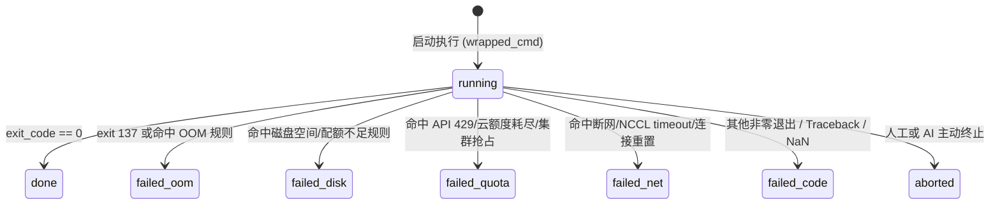

# Exploom 架构设计文档

> **定位**：AI Coding Agent 时代的**本地单一控制面实验指挥台（Experiment Lineage & Ops）**。  
> **核心价值**：解决“单本地 ZCode 通过 SSH 控制多台远端服务器 + 单项目多会话 / `/side` 分支 + 主/子智能体协作”下的实验失忆、跨机散落、断网/额度/OOM 恢复困难，以及“数据处理 → 模型微调 → 错误分析 → 再迭代”血缘追踪问题。  
> **生态位**：与 WandB / MLflow / TensorBoard **互补而非替代**——它们记录训练曲线与指标，`exploom` 管理实验血缘、多机状态、分析归因与跨会话上下文恢复。

---

## 1. 设计原则与边界（“三不做”）

1. **MVP 不做 Web UI 大盘**：终端 `Rich` 血缘树 + 表格 + 本地 Markdown 笔记足够轻量高效，不引入前后端构建复杂度。
2. **不做远端 Agent / 守护进程**：坚持**远端零侵入（Remote Zero-Install）**，仅依赖标准 SSH 与纯 POSIX/Bash 包装脚本，兼容离线机器、跳板机、Docker 容器与高校/企业集群。
3. **不强绑定单一 Coding Agent**：采用**单仓库、多端原生兼容**结构——核心为独立 Python 包（`Core + CLI + MCP`），ZCode Plugin（同时顺手兼容 Claude Code Plugin）作为薄编排层附着在仓库根目录，其他 Agent（Cursor / Codex / OpenCode）可直接复用 `SKILL.md` + `uvx` MCP。

---

## 2. 总体架构

```mermaid
flowchart TB
    subgraph Local["本地单一控制面 (ZCode / 终端)"]
        User["人类开发者"] -->|零 Token 终端操作| CLI["exploom CLI (Typer + Rich)"]
        MainAgent["主智能体 / /side 会话"] -->|5 个低歧义工具| MCP["exploom-mcp (FastMCP)"]
        SubAgent["子智能体 (AGENTS.md 自定义 / 动态继承)"] -->|MCP 或 CLI --json 兜底| MCP
        SubAgent -->|原生 Bash (受 ZCode 审批保护)| BashExec["ZCode 原生 Bash / SSH"]
        MainAgent -->|原生 Bash (受 ZCode 审批保护)| BashExec

        subgraph Plugin["ZCode Plugin 编排层"]
            Skill["skills/exploom/SKILL.md (<=60 行铁律)"]
            Cmds["commands/ (/exp, /exp-resume, /exp-sync, /exp-rerun)"]
            Hooks["hooks/ (纯标准库 ~15ms: SessionStart + PostToolUse)"]
        end

        CLI --> Core["Exploom Core (Python)"]
        MCP --> Core
        Hooks -.->|只读 SQLite ?mode=ro| DB[("~/.exploom/registry.db (SQLite WAL)")]
        Core --> DB
        Core --> Notes["~/.exploom/notes/<project>/<exp_id>.md"]
        Core --> Patches["~/.exploom/patches/<project>/<exp_id>_<n>.patch"]
    end

    BashExec -->|执行 wrapped_cmd 启动/续跑| Remote
    Core -->|并发只读 SSH: sync / drift / tail_log| Remote

    subgraph Remote["远端多台服务器 (零安装)"]
        Runner["可插拔执行器: tmux / nohup / screen / Slurm / Docker"]
        Meta["$HOME/.cache/exploom/<project>/<exp_id>_<n>/\n(meta.json, dirty.patch, exit.json)"]
        Workdir["远端工作目录 (零 Git 污染)"]
        Runner --> Meta
        Runner --> Workdir
    end
```

### 仓库目录结构（单仓四合一）

```text
exploom/
├── .zcode-plugin/
│   └── plugin.json              # ZCode 原生插件清单
├── .claude-plugin/
│   └── plugin.json              # 顺手兼容 Claude Code 插件体系
├── .mcp.json                    # 声明 exploom-mcp（优先本地二进制或 uvx 免安装）
├── skills/
│   └── exploom/
│       └── SKILL.md             # <=60 行触发器式协作纪律（通用跨 Agent）
├── commands/
│   ├── exp.md                   # /exp        查看当前项目实验树与异常高亮
│   ├── exp-resume.md            # /exp-resume 秒级注入指定实验完整上下文
│   ├── exp-sync.md              # /exp-sync   主动并发 SSH 巡检
│   └── exp-rerun.md             # /exp-rerun  漂移检查 + 生成续跑命令（走审批）
├── hooks/
│   ├── hooks.json               # 绑定 SessionStart + PostToolUse(Bash)
│   └── scripts/
│       ├── session_start.py     # 纯 Python 标准库读 SQLite（~15ms，严禁 SSH）
│       └── post_bash_check.py   # 纯 Python 标准库检测未登记后台 SSH 任务
├── pyproject.toml               # 暴露 `exploom`（及可选短别名 `exp`）与 `exploom-mcp`
├── src/exploom/
│   ├── config.py                # ~/.exploom/config.toml 加载与默认失败正则
│   ├── project.py               # 4 级混合项目解析链
│   ├── db.py                    # SQLite WAL、Schema、PRAGMA user_version 迁移
│   ├── notes.py                 # Markdown 笔记与 patch 资产管理
│   ├── classify.py              # 失败自动归类引擎 + 日志静默(stale)判定
│   ├── runners/
│   │   ├── base.py              # Runner 抽象基类（wrap + probe）
│   │   ├── tmux.py              # Phase 1: ssh-tmux（主力）
│   │   ├── nohup.py             # Phase 1: ssh-nohup
│   │   ├── local.py             # Phase 1: local
│   │   ├── custom.py            # Phase 1: custom（万能兜底）
│   │   ├── screen.py            # Phase 2: ssh-screen
│   │   ├── slurm.py             # Phase 2: ssh-slurm
│   │   └── docker.py            # Phase 2: ssh-docker
│   ├── ssh.py                   # 并发只读 SSH（ControlMaster + ConnectTimeout）
│   ├── service.py               # 核心业务服务层（CLI 与 MCP 共享）
│   ├── cli.py                   # 人类终端入口（Typer + Rich）
│   └── mcp_server.py            # 5 个核心 MCP 工具（FastMCP）
├── tests/
├── DESIGN.md
├── README.md
└── README_EN.md
```

---

## 3. 存储层与三层数据模型

### 3.1 本地资产目录（`~/.exploom/`）

```text
~/.exploom/
├── registry.db                  # SQLite 主库（WAL 模式，并发安全）
├── config.toml                  # 自定义失败正则、stale 阈值、SSH 超时、Docker meta_dir 映射
├── notes/<project>/E015.md      # 人类与 AI 共用的实验长笔记（假设、改动、bad case、结论）
└── patches/<project>/E015_1.patch # 代码漂移快照（上限 200KB）
```

### 3.2 4 级混合项目解析链（支持本地有/无代码并存）

针对“有时本地无代码纯空目录控远端、有时本地与远端双代码”的混合场景，按以下优先级解析 `project`：
1. **显式参数**：调用传入的 `project`；
2. **本地绑定**：SQLite `projects.local_roots` 中已绑定的 `cwd` 映射，或工作目录内可选的单行 `.exploom-project` 文件；
3. **Git 仓库名**：若当前目录位于本地 Git 仓库内，取根目录名称；
4. **目录兜底**：当前工作目录名（重名时附加路径短 hash 区分）。

### 3.3 SQLite Schema（WAL + 原子 ID + 版本迁移）

初始化固定开启：`PRAGMA journal_mode=WAL; PRAGMA busy_timeout=5000; PRAGMA foreign_keys=ON;`  
通过 `PRAGMA user_version` 管理增量 Schema 升级（迁移前自动备份 `registry.db.bak`）。

```sql
-- 1. 项目元信息与自增序列（保障多会话/多子智能体并发分配短 ID 不撞车）
CREATE TABLE projects (
    slug            TEXT PRIMARY KEY,
    local_root      TEXT,                 -- 绑定的本地工作目录（可空）
    next_exp_seq    INTEGER NOT NULL DEFAULT 1,
    last_synced_at  TEXT,                 -- ISO8601，用于 SessionStart 新鲜度提示
    created_at      TEXT NOT NULL
);

-- 2. 实验血缘本体（Experiment：代表一个想法 / 一版代码或数据改动）
CREATE TABLE experiments (
    project          TEXT NOT NULL REFERENCES projects(slug),
    id               TEXT NOT NULL,        -- 如 E001
    parent_id        TEXT,                 -- 血缘父实验 ID（支持 data -> finetune 跨类型挂接）
    based_on_finding TEXT,                 -- 触发本实验的分析结论 ID（如 E011-F2）
    title            TEXT NOT NULL,        -- 简短可读名，如 fix_boundary_trunc
    hypothesis       TEXT NOT NULL DEFAULT '',
    tags_json        TEXT NOT NULL DEFAULT '[]',   -- 如 ["/side", "data", "sft"]
    status_override  TEXT,                 -- NULL(由最新Attempt推导) | 'archived' | 'superseded'
    metrics_json     TEXT NOT NULL DEFAULT '{}',   -- 核心指标快照，供 exp tree 对比
    dashboard_url    TEXT,                 -- 可选 WandB / TensorBoard / SwanLab 链接
    note_path        TEXT NOT NULL,        -- ~/.exploom/notes/<project>/<id>.md
    created_at       TEXT NOT NULL,
    updated_at       TEXT NOT NULL,
    PRIMARY KEY (project, id)
);

-- 3. 执行尝试（Attempt：承载多服务器、断网/额度重跑、资源防撞车与代码指纹）
CREATE TABLE attempts (
    project          TEXT NOT NULL,
    exp_id           TEXT NOT NULL,
    attempt_no       INTEGER NOT NULL,     -- 1, 2, 3... 展示为 E015#1
    server           TEXT NOT NULL,        -- ~/.ssh/config 别名或 'local'
    workdir          TEXT NOT NULL,        -- 远端/本地绝对路径
    resource         TEXT,                 -- 可选，如 'gpu:0,1' / 'slurm:a100'
    run_cmd          TEXT NOT NULL,        -- 完整启动命令
    resume_cmd       TEXT,                 -- 断点续跑命令（为空则回退 run_cmd）
    runner           TEXT NOT NULL DEFAULT 'ssh-tmux',
    runner_ref       TEXT,                 -- tmux 会话名 / PID / Slurm JobID / 容器句柄
    log_path         TEXT,                 -- 远端主日志路径
    meta_dir         TEXT NOT NULL,        -- 远端状态落盘目录（默认 ~/.cache/exploom/...）
    git_commit       TEXT,                 -- 启动瞬间在目标 workdir 抓取的 HEAD
    git_branch       TEXT,
    diff_hash        TEXT,                 -- 启动瞬间 git diff 的 SHA256 指纹
    patch_path       TEXT,                 -- 拉回本地的补丁路径（<=200KB）
    status           TEXT NOT NULL,        -- 见第 4 节状态机
    exit_code        INTEGER,
    error_summary    TEXT,                 -- <=300 字符精简报错摘要
    metrics_json     TEXT NOT NULL DEFAULT '{}',
    log_mtime        TEXT,                 -- 最近探活到的远端日志修改时间（用于 stale 检测）
    started_at       TEXT NOT NULL,
    ended_at         TEXT,
    last_synced_at   TEXT,
    sync_error       TEXT,                 -- 如 'ssh_unreachable'（绝不覆盖原 status）
    PRIMARY KEY (project, exp_id, attempt_no),
    FOREIGN KEY (project, exp_id) REFERENCES experiments(project, id)
);

-- 4. 分析产物（Finding：挂接排查脚本、Bad Case 结论与数据输出，不污染主实验树）
CREATE TABLE findings (
    project          TEXT NOT NULL,
    id               TEXT NOT NULL,        -- 如 E015-F1
    exp_id           TEXT NOT NULL,
    attempt_no       INTEGER,              -- 可选关联到某次具体尝试
    kind             TEXT NOT NULL,        -- 'analysis' | 'diagnosis' | 'decision' | 'artifact'
    summary          TEXT NOT NULL,        -- 一句话核心发现
    artifacts_json   TEXT NOT NULL DEFAULT '[]', -- [{"server": "gpu-1", "path": "scripts/err.py"}]
    created_at       TEXT NOT NULL,
    PRIMARY KEY (project, id),
    FOREIGN KEY (project, exp_id) REFERENCES experiments(project, id)
);
```

---

## 4. 状态机、日志静默告警与失败自动归类

### 4.1 双层状态解耦

- **`Experiment` 状态**：除非设置了 `status_override`（`archived` / `superseded`），否则**动态推导**——无 Attempt 时为 `planned`，否则等于最新 `Attempt.status`。彻底杜绝两张表状态不一致。
- **`Attempt` 状态机**：



### 4.2 三条关键判定护栏

1. **SSH 不可达 ≠ 实验失败**：`sync` 时若目标服务器网络超时或关机，只写入 `sync_error = "ssh_unreachable"`，**保留原 `status`**，防止误报。
2. **日志静默（`stale`）告警**：若进程存活（`running`），但 `now - log_mtime > stale_threshold_minutes`（默认 45 分钟，可在 `config.toml` 配置），在 `tree` / `list` / `SessionStart` 中标黄显示 `running (stale 2h)`，零开销揪出多卡 NCCL 死锁或数据加载 hang 死。
3. **可扩展失败分类引擎**：匹配顺序为 `exit_code == 0 → done` → `config.toml` 用户自定义正则 → 内置训练/数据/API 规则 → `failed_code` 兜底。内置规则重点覆盖：
   - `failed_oom`：`exit_code in (137, -9)`、`CUDA out of memory`、`torch.cuda.OutOfMemoryError`、`OutOfMemoryError`、`OUT_OF_MEMORY`（Slurm）
   - `failed_disk`：`No space left on device`、`Disk quota exceeded`、`ENOSPC`
   - `failed_quota`：`insufficient_quota`、`429`、`RateLimit`、`PREEMPTED`（Slurm）、`TIMEOUT`（Slurm 限时耗尽）
   - `failed_net`：`NCCL.*timeout`、`ConnectionResetError`、`ReadTimeout`、`BrokenPipeError`、`Temporary failure in name resolution`
   - `failed_code`：`Traceback`、`RuntimeError`、`AssertionError`、`Loss is NaN` 及其他非零退出

---

## 5. 远端零侵入协议与可插拔 Runner

### 5.1 统一状态落盘协议（零污染远端 Git）

远端运行元数据统一写入 `$HOME/.cache/exploom/<project>/<exp_id>_<attempt_no>/`（Docker 场景可在 `config.toml` 中按 `server` 覆盖为宿主机与容器共享挂载目录，如 `/data/.exploom_meta`）。

`wrapped_cmd` 在远端启动瞬间自动完成 4 件事（**零额外 SSH 往返**）：
1. **抓取代码指纹**：若 `workdir` 是 Git 仓库，记录 `git rev-parse HEAD`、分支名、`git diff` 的 SHA256 与前 200KB `dirty.patch` 到 `meta.json` 与 `dirty.patch`；非 Git 目录优雅降级记录 `git_commit: null`。
2. **记录启动信息**：将 `pid`、`started_at`、`workdir`、`log_path` 写入 `meta.json`。
3. **安全执行与日志落盘**：执行真实 `run_cmd`（或 `resume_cmd`），保留用户原有 conda/venv 环境，并确保标准输出/错误写入 `log_path`。
4. **退出钩子（`trap`）**：无论正常结束、报错退出还是收到 `SIGTERM`/`SIGINT`，退出时自动写 `exit.json`（`{"exit_code": $rc, "ended_at": "..."}`）。

### 5.2 代码漂移检测（防重跑污染实验）

在 `prepare_rerun` / `exploom rerun` 时，通过一次只读 SSH 计算目标 `server:workdir` 当前的 `(git_commit, diff_hash)` 并与原 Attempt 对比：
- **一致**：直接生成新 Attempt 的续跑命令（优先 `resume_cmd`，否则 `run_cmd`）；
- **漂移**：默认阻断，返回“原 commit / 当前 commit / diff 是否变化”的清晰警告；仅当用户显式确认（`--force` / `force_on_drift=true`）才放行。

### 5.3 Runner 抽象与分期实现

每个 Runner 仅实现两个方法：`build_wrapped_cmd(spec) -> str` 和 `build_probe_cmd(attempt) -> str`。

| 分期 | Runner | `runner_ref` | 探活机制（只读 SSH） |
| :--- | :--- | :--- | :--- |
| **Phase 1 (MVP)** | `ssh-tmux`（默认） | `exp_<proj>_<id>_<n>` | `tmux has-session -t <ref>` + 读 `exit.json` + `stat` 日志 mtime |
| **Phase 1 (MVP)** | `ssh-nohup` | 远端 `PID` | `kill -0 <pid>` + 读 `exit.json` + `stat` 日志 mtime |
| **Phase 1 (MVP)** | `local` | 本地 `PID` / tmux | 本地直接检查，无 SSH |
| **Phase 1 (MVP)** | `custom` | 用户自定义标识 | 仅按 `exit.json` / 日志 mtime 或手动更新状态 |
| **Phase 2** | `ssh-screen` | screen 会话名 | `screen -ls` 匹配 + `exit.json` |
| **Phase 2** | `ssh-slurm` | Slurm `JobID` | `squeue -j <id>` + `sacct -j <id> -o State,ExitCode`（精准拿 OOM/TIMEOUT/PREEMPTED） |
| **Phase 2** | `ssh-docker` | `container:ref` | 宿主机读共享挂载 `meta_dir` 的 `exit.json` + `docker inspect/exec` |

> **SSH 并发优化**：`sync` 对同一台 `server` 上的多个 `running` 实验合并为单次 SSH 批量探活脚本，跨服务器用线程池并发，统一设置 `ConnectTimeout=5`、`BatchMode=yes`（禁止卡在密码输入）与 `ControlMaster=auto`。

---

## 6. 5 个核心 MCP 工具契约与 CLI 映射

### 6.1 安全审批边界（核心设计）

- **MCP 层严格保持“本地读写 + 只读 SSH”**：**绝不在 MCP 子进程里静默启动或重跑远端实验**。
- 所有远端启动和续跑命令由 `exp_attempt` / `exp_ops(prepare_rerun)` 生成后返回，**交由 ZCode 原生 Bash 工具执行**——天然享受 ZCode 工具审批弹窗保护，且 100% 复用用户真实终端的 SSH Agent 与跳板机环境。
- 人类在本地终端主动敲 `exploom rerun E015` 时，CLI 可直接通过 SSH 拉起（受人工终端显式触发保护）。

### 6.2 5 个 MCP 工具定义（低歧义、控 Token）

| 工具名 | 职责 | 关键入参 | 精简出参 |
| :--- | :--- | :--- | :--- |
| **`exp_plan`** | 创建/更新实验节点（主智能体派单、`/side` 分叉、数据→微调挂接） | `action` (`create`\|`update`), `exp_id?`, `parent_id?`, `based_on_finding?`, `title`, `hypothesis?`, `tags?`, `metrics?`, `status_override?`, `dashboard_url?`, `project?` | `{exp_id, parent_id, note_path, status}` |
| **`exp_attempt`** | 登记一次运行尝试 / 更新状态指标；`start` 时做资源防撞车并返回 `wrapped_cmd` | `action` (`start`\|`update`), `exp_id`, `attempt_no?`, `server`, `workdir`, `resource?`, `run_cmd`, `resume_cmd?`, `runner?`, `log_path?`, `status?`, `error_summary?`, `metrics?` | `start`: `{exp_id, attempt_no, runner_ref, wrapped_cmd, ssh_cmd, conflict_warnings}`<br>`update`: `{exp_id, attempt_no, status}` |
| **`exp_finding`** | 挂接分析脚本、Bad Case 归因、数据输出路径或追加 Markdown 笔记 | `exp_id`, `attempt_no?`, `kind` (`analysis`\|`diagnosis`\|`decision`\|`artifact`), `summary`, `artifacts?`, `note_append?` | `{finding_id, exp_id, note_path}` |
| **`exp_query`** | 纯本地毫秒级只读查询（严控返回体积，绝不倒灌全量日志） | `view` (`tree`\|`list`\|`context`\|`resources`), `exp_id?`, `status_filter?`, `server?`, `tag?`, `include_findings?`, `all_projects?` | `tree`: 紧凑树文本 + `last_synced_at`<br>`list`: 精简卡片列表<br>`context`: 元信息 + 祖先链 + 最近 2 次 Attempt + 全部 Findings + Markdown 笔记 + patch 变更文件清单<br>`resources`: 在跑 `server/workdir/resource` 占用表 |
| **`exp_ops`** | 唯一触发只读 SSH 的运维工具（巡检、查日志、重跑预检） | `action` (`sync`\|`tail_log`\|`prepare_rerun`), `exp_id?`, `use_resume?`(默认 true), `force_on_drift?`(默认 false), `lines?`(默认 50, 上限 200) | `sync`: 状态变更与 stale 清单<br>`tail_log`: 末尾 N 行日志<br>`prepare_rerun`: 漂移检查结果 + 新 Attempt 的 `ssh_cmd`（供 ZCode 原生 Bash 审批执行） |

### 6.3 人类 CLI (`exploom`) 映射

所有 CLI 命令支持 `--json`（同时作为无 MCP 权限子智能体的无缝兜底）：

| 命令 | 用途 |
| :--- | :--- |
| `exploom init [project]` | 将当前目录绑定到指定项目名（适合无代码本地工作区） |
| `exploom tree [-a] [--all]` | `Rich` 彩色血缘树（`-a` 展开分析记录，`--all` 跨项目） |
| `exploom ls [--failed] [--running] [--server X]` | 按状态/服务器筛选实验 |
| `exploom show <E0xx>` / `exploom edit <E0xx>` | 查看完整上下文 / 用 `$EDITOR` 打开 Markdown 笔记 |
| `exploom ps` | 查看当前所有服务器/GPU/资源占用矩阵 |
| `exploom sync [E0xx]` | 并发 SSH 探活、更新状态、拉取失败 patch 与摘要、标记 stale |
| `exploom log <E0xx> [-n 80]` | 快速拉取远端主日志尾部 |
| `exploom rerun <E0xx> [--fresh] [--force]` | 漂移检查后通过 SSH 直接拉起 `resume_cmd`（`--fresh` 用 `run_cmd`） |

---

## 7. ZCode Plugin 编排层设计

### 7.1 主/子智能体协作协议（兼容自定义 `AGENTS.md` 与动态子智能体）

**原则**：插件**不内置**强制性的 `agents/` 配置，不干扰用户在 `AGENTS.md` 中的专属 Agent 编排；协议仅靠 **任务提示头 `[EXP_ID=E0xx]` + 共享本地 SQLite** 运转：

1. **主智能体派单前**：调 `exp_query(resources)` 防撞车 → 调 `exp_plan(create)` 建好 `E016`（状态 `planned`）→ 在派发给子智能体（无论是自定义 Agent 还是临时继承式子智能体）的提示词开头写入 `[EXP_ID=E016]`。
2. **子智能体接单**：先调 `exp_query(context, E016)` 还原上下文（无须主智能体转述长历史）；若当前子智能体无 MCP 权限，降级调 `exploom ... --json`。
3. **子智能体执行与落盘**：跑实验前调 `exp_attempt(start)` 用返回的 `ssh_cmd` 通过 Bash 提交；分析完错误调 `exp_finding` 登记脚本与结论。
4. **子智能体收尾回报**：**仅向主智能体汇报 3 行精简摘要**（`ID#attempt | status & 核心指标/报错 | finding ID`），保护主上下文不被长日志污染。

### 7.2 `SKILL.md` 规范（严格控制在 60 行以内）

采用“触发条件 → 必做动作”决策表，核心仅保留 5 条铁律：
1. **远端/本地提交耗时训练或数据处理任务前** → 必先 `exp_plan`（若无 ID）+ `exp_attempt(start)`，并用返回的包装命令经 Bash 提交。
2. **主智能体派发子智能体做实验或排查前** → 必先 `exp_plan` 分配 ID，并在子任务提示词中传递 `[EXP_ID=...]`。
3. **`/side` 中衍生新改动或排查脚本时** → 结合 `SessionStart` 注入的最近活跃节点自动推断 `parent_id`，顺嘴确认一句即可落地并打上 `"/side"` 标签。
4. **分析脚本得出错误归因或实验中途失败时** → 必调 `exp_finding` 或 `exp_attempt(update)` 落盘精确状态与结论，禁止只口头回复。
5. **用户提及某个实验 ID（如“接着搞 E015”）** → 第一动作必调 `exp_query(context, E015)`，不翻聊天记录猜测。

*(README 中额外提供 3 行可选的 `AGENTS.md` 接入片段，方便用户显式串联自己的定制子智能体。)*

### 7.3 Hooks（纯 Python 标准库、~15ms、零第三方依赖）

- **`SessionStart` (`hooks/scripts/session_start.py`)**：
  - 仅以只读 URI 模式（`?mode=ro`）打开 `~/.exploom/registry.db`，**严禁任何网络/SSH 操作**；数据库不存在时静默退出。
  - 注入 ≤120 Token 态势卡片（项目名、`last_sync` 时间、在跑及 stale 列表、待续跑的 `failed_quota/failed_net/failed_oom/failed_disk` 列表、最近 3 个活跃节点）。
- **`PostToolUse` (`hooks/scripts/post_bash_check.py`，仅匹配 Bash 工具)**：
  - **低噪音策略（方案 A）**：仅当命令同时满足 ① 包含 `ssh `、② 启动了疑似后台长任务（`tmux` / `nohup` / `screen` / `sbatch` / 后台 `&`）、③ 不含 `exploom` wrapper 标记时，返回一条**非阻断的轻量提醒**，提示 AI 如属正式实验可用 `exp_attempt` 补登。日常 `ssh` 看 `nvidia-smi`、`ls`、`cat` 完全静默。

### 7.4 4 个 Slash Commands

- `/exp`：调用 `exp_query(tree)` 输出当前项目血缘树，高亮 `running`、`stale` 及可续跑失败节点。
- `/exp-resume <E0xx>`：调用 `exp_query(context, E0xx)`，一秒恢复该实验的祖先链、服务器目录、历史报错、关联分析脚本与笔记，直接进入续工状态。
- `/exp-sync`：调用 `exp_ops(sync)` 并发巡检所有远端在跑实验，汇总刚完成、卡死（stale）及失败原因。
- `/exp-rerun <E0xx>`：调用 `exp_ops(prepare_rerun, E0xx)` 检查代码漂移并展示 `resume_cmd`，确认后走 ZCode 原生 Bash 审批拉起。

---

## 8. 实施路线图与验收标准

| 阶段 | 核心交付 | 验收标准（Definition of Done） |
| :--- | :--- | :--- |
| **M1：核心内核与 CLI** | `pyproject.toml`、`db.py`、`project.py`、`notes.py`、`classify.py`、`service.py`、`cli.py` + 单元测试 | 本地跑通 `init / plan / attempt / finding / tree / ls / show / ps`，WAL 并发读写无锁报错，Schema 迁移与单元测试全绿 |
| **M2：远端 Wrapper 与 SSH 引擎** | `runners/{base,tmux,nohup,local,custom}.py`、`ssh.py`（批量并发探活 + 漂移检测 + `tail_log` + `stale` 判定） | 在真实 SSH 机器上跑通：`wrapped_cmd` 零污染 Git 目录、正常退出与异常退出（OOM/断网/磁盘满）精准归类、代码修改后 `rerun` 触发漂移阻断 |
| **M3：MCP Server 与 ZCode Plugin** | `mcp_server.py`（5 工具）、`.zcode-plugin/plugin.json`、`.claude-plugin/plugin.json`、`.mcp.json`、`SKILL.md`、4 个 `commands/`、2 个纯标准库 `hooks/` | ZCode 加载插件无报错；`SessionStart` <30ms 注入摘要；主/子智能体与 `/side` 完整走通派单→审批启动→分析回写→新会话 `/exp-resume` 闭环 |
| **M4：多执行器扩展与开源发布** | `runners/{screen,slurm,docker}.py`、中英双语 `README`、示例配置、PyPI / GitHub 发布 | `uvx --from exploom exploom-mcp` 免安装可用；覆盖 Docker 挂载 `meta_dir` 与 Slurm `sacct` 状态解析 |
