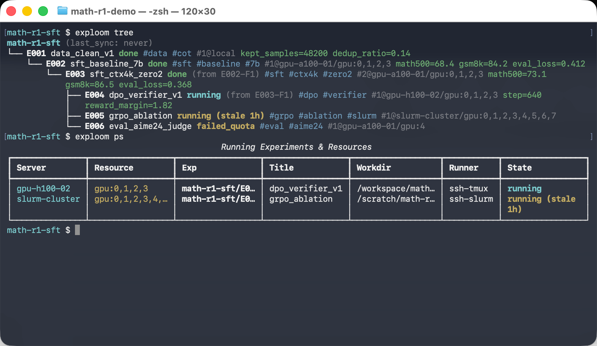
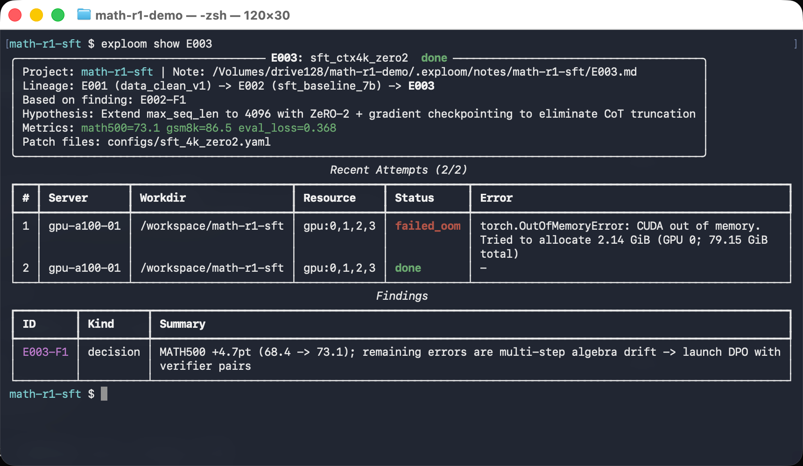
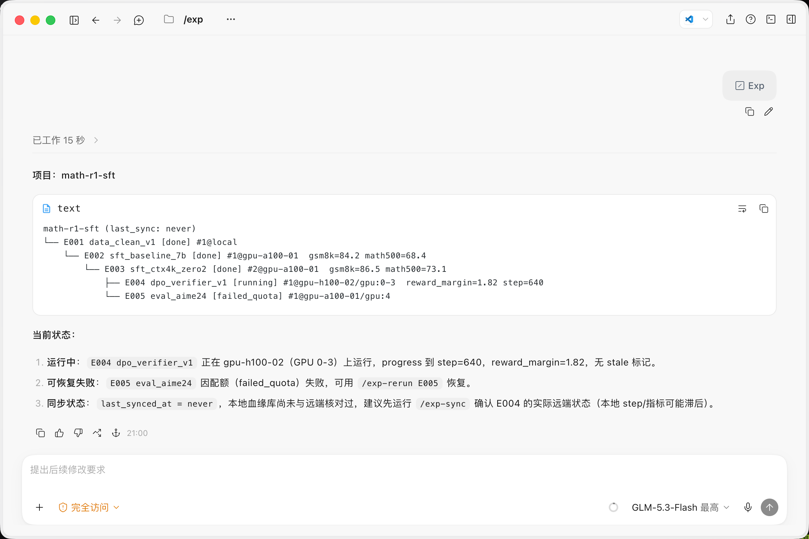
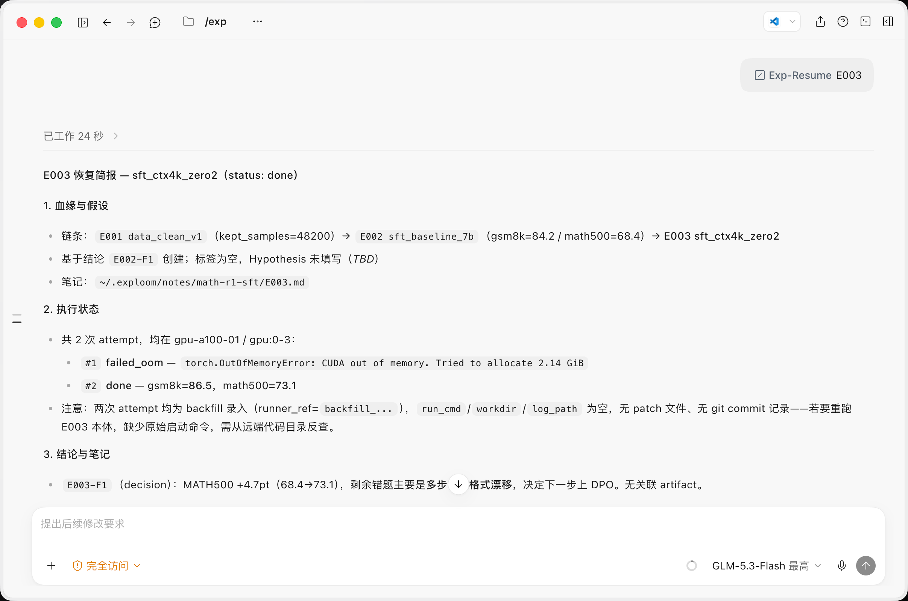

<p align="center">
  
</p>

# Exploom

**AI Coding Agent 时代的本地单一控制面实验指挥台（Experiment Lineage & Ops）。**

[English README](README_EN.md) · [架构设计文档 (DESIGN.md)](DESIGN.md)

Exploom 专为“单本地 Coding Agent 通过 SSH 控制多台远端 GPU 服务器 + 单项目多会话 / `/side` 分叉 + 主/子智能体协作”场景打造，解决实验失忆、跨机散落、OOM/额度/断网恢复困难，以及“数据处理 → 模型微调 → 错误分析 → 再迭代”的完整血缘追踪问题。

它与 WandB / MLflow / TensorBoard **互补而非替代**：它们记录训练曲线与指标，`exploom` 管理**实验血缘、多机状态、失败归因与跨会话秒级上下文恢复**。

---

## 核心特性

- **远端零侵入（Remote Zero-Install）**：远端服务器无需安装任何 Agent 或依赖，仅靠标准 SSH + 纯 POSIX/Bash 包装脚本落盘状态，绝不污染远端 Git 仓库。
- **本地 SQLite WAL 单一控制面**：多会话与子智能体并发读写安全（`~/.exploom/registry.db`），搭配人类与 AI 共用的 Markdown 笔记（`~/.exploom/notes/`）及代码补丁快照（`~/.exploom/patches/`）。
- **安全审批边界**：MCP 工具严格限制为“本地读写 + 只读 SSH”，所有远端启动和续跑命令都返回给宿主 Agent 的原生 Bash 工具执行，天然享受审批弹窗保护与本机真实 SSH Agent / 跳板机环境。
- **失败自动归类与日志静默（Stale）告警**：自动识别 `failed_oom`、`failed_disk`、`failed_quota`、`failed_net`、`failed_code`、`aborted`；检测挂死任务（`running (stale 2h)`）；SSH 不可达时仅记 `sync_error` 绝不误改原状态。
- **代码漂移保护**：续跑前自动比对远端 `(git_commit, diff_hash)`，代码发生变化时默认阻断，防止污染原实验。
- **7 种可插拔执行器**：`ssh-tmux`（默认）、`ssh-nohup`、`ssh-screen`、`ssh-slurm`（支持 `sacct` 精准解析 `OUT_OF_MEMORY`/`TIMEOUT`/`PREEMPTED`）、`ssh-docker`（支持宿主机共享挂载 `meta_dir`）、`local`、`custom`。
- **单仓四合一**：独立 Python 包（`exploom` CLI + `exploom-mcp`）+ ZCode / Claude Code Plugin 薄编排层（`SKILL.md`、5 个 Slash Commands 含 `/exp-collect`、2 个纯标准库 Hooks）。

---

## 实景演示

| 终端血缘树与多机 GPU 占用（`exploom tree` + `exploom ps`） | 失败归因、补丁与 Findings 详情（`exploom show E003`） |
| :---: | :---: |
|  |  |
| **Agent 一键实验全景态势（`/exp`）** | **跨会话零 SSH 秒级恢复上下文（`/exp-resume E003`）** |
|  |  |

---

## 兼容矩阵

Exploom 核心是标准的 Python CLI + MCP Server，不绑定特定工具，主流 AI Coding Agent 与纯终端均可使用：

| 使用方式 | 支持的工具 | 可用能力 |
| :--- | :--- | :--- |
| **一键插件（最完整）** | **ZCode**、**Claude Code** | 5 个 MCP 工具 + `SKILL.md` + 5 个 Slash Commands + 2 个自动 Hooks 全套生效 |
| **通用 MCP + Rules** | **Cursor、Codex、Windsurf、Cline、Gemini CLI** 等任何支持 MCP 的 Agent | 配上 `exploom-mcp`（或 `uvx`）即可用全部 5 个 MCP 工具；配合 `exploom integrate` 或 `skills/exploom/SKILL.md` 自动协作（仅无两个自动 Hooks） |
| **纯 CLI（零依赖 MCP）** | **任意支持 Bash 的 Agent**、无 MCP 权限的子智能体、或**人类终端** | `exploom` / `exp` 完整命令集，所有子命令均支持 `--json` |

---

## 快速开始

### 一句话让 AI Agent 自动安装（推荐）

直接把下面这句话发给你的 Claude Code / ZCode / 任意 Coding Agent：

```text
帮我安装并配置 Exploom（https://github.com/minghuaxu/exploom）：参考仓库 README，用 uv tool install git+https://github.com/minghuaxu/exploom.git（无 uv 则用 pip）安装 CLI 与 MCP Server，按我当前使用的 Agent 完成插件/MCP 接入并验证 exploom --help 可用；如需修改 AGENTS.md/CLAUDE.md 请先征求我同意。
```

---

### 1. 手动安装（CLI + MCP）

```bash
# 直接从 GitHub 使用 uv 安装
uv tool install git+https://github.com/minghuaxu/exploom.git
# 或本地源码可编辑安装
uv tool install -e .
```

也支持 `uvx` 免安装直接运行 MCP Server：

```bash
uvx --from git+https://github.com/minghuaxu/exploom.git exploom-mcp
```

### 2. 作为 ZCode / Claude Code 插件加载

将本仓库作为本地目录或 GitHub Marketplace 源添加即可一键安装：
- **ZCode**：**插件市场 → 添加 → 添加插件市场** → 填入 `https://github.com/minghuaxu/exploom`（或本地仓库目录）→ 安装 `exploom`。
- **Claude Code**：执行 `/plugin marketplace add minghuaxu/exploom`，再执行 `/plugin install exploom@exploom`。

加载后自动生效：
- `.zcode-plugin/plugin.json` 与 `.zcode-plugin/marketplace.json`
- `.claude-plugin/plugin.json` 与 `.claude-plugin/marketplace.json`
- `.mcp.json`（优先使用本地 `exploom-mcp`，未安装时自动回退 `uvx --from git+https://github.com/minghuaxu/exploom.git exploom-mcp`）
- `skills/exploom/SKILL.md`（<=60 行触发器式铁律）
- 5 个 Slash Commands：`/exp`、`/exp-resume <E0xx>`、`/exp-sync`、`/exp-rerun <E0xx>`、`/exp-collect`
- 2 个纯标准库 Hooks：`SessionStart`（~15ms 只读 SQLite 注入态势卡片）与 `PostToolUse(Bash)`（低噪音检测未登记后台 SSH 任务）

### 3. 其他支持 MCP 的 Agent（Cursor / Codex / Windsurf / Cline / Gemini CLI 等）

将以下配置加入对应工具的 MCP 配置文件即可接入全部 5 个 MCP 工具（若已安装 `exploom-mcp`，也可直接把 `command` 设为 `"exploom-mcp"` 并省略 `args`）：

```json
{
  "mcpServers": {
    "exploom": {
      "command": "uvx",
      "args": ["--from", "git+https://github.com/minghuaxu/exploom.git", "exploom-mcp"]
    }
  }
}
```

> 建议同时把 [`skills/exploom/SKILL.md`](skills/exploom/SKILL.md) 加入该工具的 Rules，或在项目目录运行 `exploom integrate --lang zh` 写入 `./AGENTS.md`，让 Agent 自动遵守实验登记与汇报规范。

### 4. 可选 `AGENTS.md` 接入（串联自定义子智能体）

插件默认开箱即用，不会静默修改你的全局配置。如果你使用了自定义 `AGENTS.md` / `CLAUDE.md` 子智能体编排，可运行一条幂等命令一键接入（使用 `<!-- exploom:start -->` 标记块，绝不覆盖原有内容，随时可 `--remove` 干净移除）：

```bash
exploom integrate --zcode --lang zh      # 写入 ~/.zcode/AGENTS.md
exploom integrate --claude --lang zh     # 写入 ~/.claude/CLAUDE.md
exploom integrate --lang zh              # 写入当前项目的 ./AGENTS.md
exploom integrate --zcode --remove       # 一键干净移除
```

或手动加入以下 3 行：

```markdown
- 提交远端/本地训练或派发子智能体前，先调 `exp_plan` 分配 ID，并在任务提示词开头写入 `[EXP_ID=E0xx]`。
- 收到 `[EXP_ID=E0xx]` 的子智能体先调 `exp_query(view="context", exp_id="E0xx")`（无 MCP 时用 `exploom show E0xx --json`）还原上下文，通过 `exp_attempt(action="start")` 启动任务，并用 `exp_finding` 落盘结论。
- 子智能体仅向主智能体回报 3 行精简摘要：`E0xx#<attempt> | 状态与核心指标/报错 | finding ID`。
```

---

## 5 个核心 MCP 工具

| 工具 | 职责 |
| :--- | :--- |
| `exp_plan` | 创建/更新实验血缘节点（`parent_id`、`based_on_finding`、`tags`、`metrics`、`status_override`）。 |
| `exp_attempt` | 登记执行尝试（`start`：防撞车并返回 `ssh_cmd`，不直接执行）、补录历史/已在运行尝试（`record`，不触发启动）或更新状态与指标（`update`）。 |
| `exp_finding` | 挂接分析脚本、Bad Case 诊断、决策与产物路径，并自动追加到实验 Markdown 笔记。 |
| `exp_query` | 纯本地毫秒级只读查询（`tree` / `list` / `context` / `resources`），零 SSH。 |
| `exp_ops` | 唯一触发只读 SSH 的工具：`sync`（并发批量探活）、`tail_log`（<=200 行）、`prepare_rerun`（漂移检测 + 返回 `ssh_cmd`）。 |

## 人类终端 CLI (`exploom` / `exp`)

所有命令均支持 `--json`（同时作为无 MCP 权限子智能体的兜底入口）：

```bash
exploom init [project]                     # 将当前目录绑定到项目名
exploom plan -t "sft_v1" -H "lr=2e-5"      # 创建实验节点
exploom attempt start E001 -s gpu-1 -w /work -r gpu:0,1 -c "python train.py"
exploom tree [-a] [--all]                  # Rich 彩色血缘树
exploom ls [--failed] [--running] [--server gpu-1]
exploom show E001                          # 查看完整上下文（血缘、尝试、Findings、patch 文件）
exploom edit E001                          # 用 $EDITOR 打开 Markdown 笔记
exploom ps                                 # 查看所有服务器/GPU/目录占用矩阵
exploom sync [E001]                        # 并发只读 SSH 探活
exploom log E001 -n 80                     # 拉取远端主日志尾部
exploom rerun E001 [--fresh] [--force]     # 漂移检查后直接续跑
exploom integrate [--zcode|--claude]       # 一键幂等接入/移除 AGENTS.md 子智能体接力块
```

## 可插拔执行器

| Runner | `runner_ref` | 探活机制 |
| :--- | :--- | :--- |
| `ssh-tmux`（默认） | `exp_<proj>_<id>_<n>` | `tmux has-session` + `exit.json` + 日志 mtime |
| `ssh-nohup` | PID（`$META_DIR/pid`） | `kill -0` + `exit.json` + 日志 mtime |
| `ssh-screen` | `exp_<proj>_<id>_<n>` | `screen -ls` + `exit.json` + 日志 mtime |
| `ssh-slurm` | Slurm `JobID` | `squeue -j` + `sacct -o State,ExitCode`（精准解析 `OUT_OF_MEMORY`/`TIMEOUT`/`PREEMPTED`/`CANCELLED`） |
| `ssh-docker` | `<container>:<ref>` | 宿主机读共享挂载 `meta_dir` + `docker inspect` / `docker exec kill -0` |
| `local` | 本地 PID | 本地直接检测，无 SSH |
| `custom` | 自定义标识 | `exit.json` / 日志 mtime 或手动 `exp_attempt(update)` |

## 配置文件

将 [`examples/config.toml`](examples/config.toml) 复制到 `~/.exploom/config.toml`，即可自定义 `stale_threshold_minutes`、`ssh_connect_timeout`、自定义失败正则，以及 Docker / Slurm 共享 `meta_dir` 挂载路径。

## 许可证

[MIT](LICENSE)
